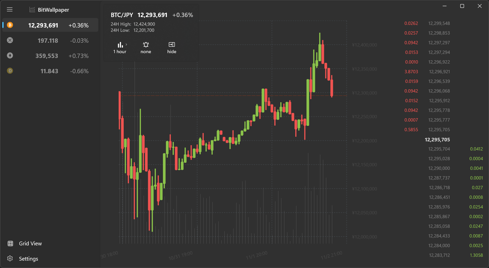
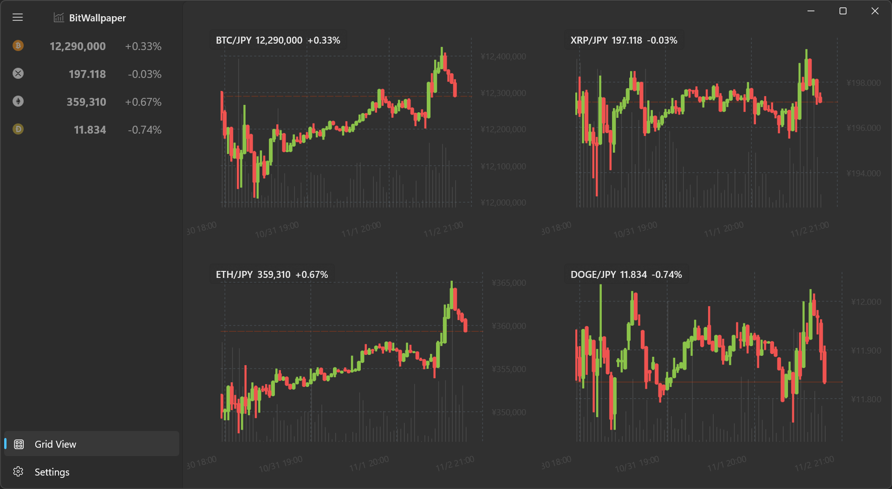

# BitWallpaper

## Cryptocurrency charting app
Displays cryptocurrency charts using [BitBank](https://bitbank.cc/)'s [public API](https://github.com/bitbankinc/bitbank-api-docs). No registration required. 

Pairs: BTC/JPY, XRP/JPY, ETH/JPY, LTC/JPY, MONA/JPY, BCC/JPY, XLM/JPY, QTUM/JPY, BAT/JPY, OMG/JPY, XYM/JPY, LINK/JPY, BOBA/JPY, DOT/JPY, DOGE/JPY, ASTR/JPY, ADA/JPY, AVAX/JPY, AXS/JPY, FLR/JPY, SAND/JPY.

## Download
 Download and install via [Microsoft Store](https://apps.microsoft.com/store/detail/bitwallpaper/9NCC3NTG9DP3)
 
## Screenshots

